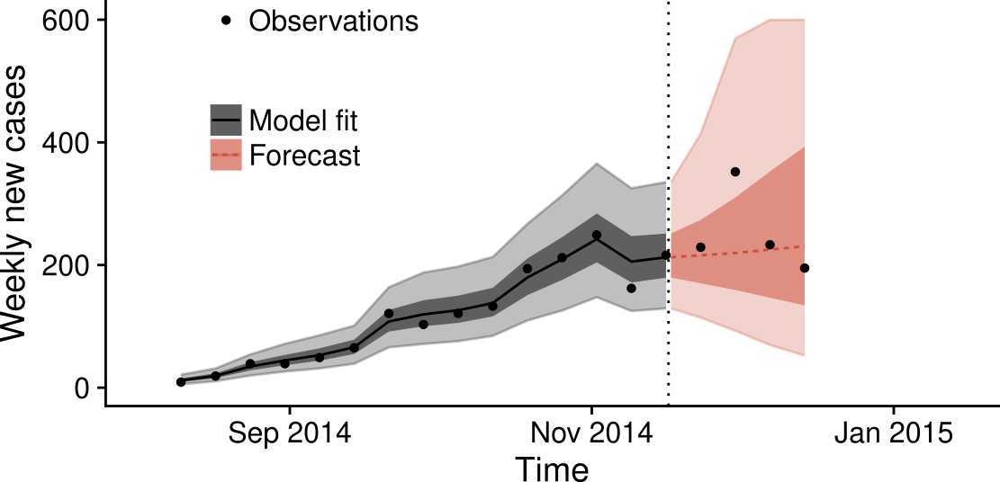

```{r setup, include=FALSE}
knitr::opts_chunk$set(echo = FALSE)
```

<br><br>
We are a research group based at the [Centre for Mathematical Modelling of Infectious Diseases](https://www.lshtm.ac.uk/research/centres/centre-mathematical-modelling-infectious-diseases) of the [London School of Hygiene & Tropical Medicine](https://www.lshtm.ac.uk) developing methodology and tools for real-time modelling and forecasting of infectious disease outbreaks. We systematically assess these methods by their predictive ability and apply them in order to improve decision making. Ultimately, our goal is to develop and use robust methodology that makes the most of available resources to provide insights useful for outbreak response, control and prevention, and to make them available as tools to others. <br><br>
We often work in collaboration with a number of
other research groups, public health agencies such as the [UK Health Security Agency](https://www.gov.uk/government/organisations/uk-health-security-agency), the [European Centre for Disease Control and Prevention](https://www.ecdc.europa.eu/en) and the [World Health Organization](https://www.who.int/), and non-governmental
organisations such as [Médecins Sans Frontières](https://www.msf.org/).

::: {.column-margin}

<script async src="https://bst.heion.net/timeline.js" data-handle="epiforecasts.io" data-theme="light" data-width="420" data-height="500" data-lang="en" data-pin="0"></script>

<script>
// The widget takes its theme as a URL parameter of the iframe it inserts, so
// keep that parameter in step with Quarto's light/dark toggle
(function () {
  const container = document.currentScript.parentElement;
  function sync() {
    const theme = document.body.classList.contains("quarto-dark") ? "dark" : "light";
    container.querySelectorAll('iframe[src*="blueskytimeline.com"]').forEach(function (frame) {
      const url = new URL(frame.src);
      if (url.searchParams.get("theme") !== theme) {
        url.searchParams.set("theme", theme);
        // a fresh iframe loads without adding a browser history entry,
        // which changing the src of a loaded one would
        const fresh = frame.cloneNode();
        fresh.src = url.toString();
        frame.replaceWith(fresh);
      }
    });
  }
  // the toggle changes the body's class; the widget adds its iframe later
  new MutationObserver(sync).observe(document.body, {
    attributes: true,
    attributeFilter: ["class"]
  });
  new MutationObserver(sync).observe(container, { childList: true, subtree: true });
  sync();
})();
</script>

:::
